# **DAW_Actividad_2_2** **HTTPS con certificado** **autofirmado** **en Apache**
## **1. Introducción**
En esta práctica se ha configurado un servidor web Apache en una instancia de Amazon EC2 con Ubuntu Server, habilitando el protocolo HTTPS mediante un certificado digital autofirmado.

El objetivo es instalar y configurar Apache, generar un certificado SSL/TLS, habilitar el acceso seguro mediante HTTPS y comprobar que las conexiones y redirecciones funcionan correctamente.
## **2. Entorno de trabajo**
Para realizar la práctica se han utilizado las siguientes herramientas y tecnologías:

- **Amazon Web Services (AWS):** servicio utilizado para crear y administrar la instancia EC2.

- **Ubuntu Server:** sistema operativo instalado en la instancia.

- **Apache2:** servidor web encargado de servir el contenido.

- **OpenSSL:** herramienta utilizada para generar el certificado autofirmado.

- **Git y GitHub:** herramientas utilizadas para gestionar y almacenar el proyecto.

- **HTTPS/TLS:** protocolo utilizado para establecer conexiones cifradas.
### **Datos de configuración**

| **Elemento** | **Valor** |
| :---: | :---: |
| Sistema operativo | Ubuntu Server |
| Servidor web | Apache2 |
| Dominio | `practica-https.test` |
| IP elástica | `54.145.30.147` |
| Puerto HTTP | 80 |
| Puerto HTTPS | 443 |
| Tipo de certificado | Autofirmado |
| Algoritmo de clave | RSA 2048 bits |
| Validez del certificado | 365 días |
## **3. Estructura del proyecto**
El repositorio contiene la siguiente estructura:

`OSB-practica-01-04/` `│` `├── README.md` `├── .gitignore` `│` `├── conf/` `│   ├── 000-default.conf` `│   └── practica-https-ssl.conf` `│` `└── scripts/` `    ├── .env.example` `    ├── install_apache.sh` `    └── setup_selfsigned_certificate.sh`
### **Descripción de los archivos**
- **README.md:** documentación del proyecto y explicación de las pruebas realizadas.

- **.gitignore:** evita subir archivos privados o generados, como `.env` y las claves privadas.

- **conf/000-default.conf:** configuración del sitio HTTP para redirigir las peticiones hacia HTTPS.

- **conf/practica-https-ssl.conf:** configuración del sitio HTTPS, incluyendo las rutas del certificado y de la clave privada.

- **scripts/.env.example:** plantilla con las variables necesarias para configurar el certificado.

- **scripts/install_apache.sh:** instala Apache2 y comprueba si ya está instalado para evitar repetir la instalación.

- **scripts/setup_selfsigned_certificate.sh:** genera el certificado autofirmado y configura Apache para utilizar HTTPS.
## **4. Creación y configuración de la instancia EC2**
Se ha creado una instancia EC2 en AWS utilizando Ubuntu Server LTS.

Se ha configurado un grupo de seguridad permitiendo las conexiones entrantes necesarias:

- Puerto 22: conexión SSH para administrar la instancia.

- Puerto 80: acceso mediante HTTP.

- Puerto 443: acceso mediante HTTPS.

También se ha asignado una dirección IP elástica a la instancia para mantener una dirección pública estable.
## **5. Instalación de Apache**
Una vez conectados a la instancia mediante SSH, se ha ejecutado el script `install_apache.sh`.

Este script comprueba primero si Apache ya está instalado. Si no lo está, actualiza los repositorios, instala el servidor web y habilita su inicio automático.

Para ejecutar el script se utiliza:

`sudo ./scripts/install_apache.sh`

Después se ha comprobado el estado del servicio:

`sudo systemctl status apache2`
###  **Instalación de Apache**

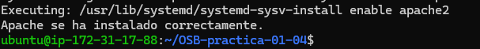
En esta captura se muestra la ejecución del script de instalación de Apache y el resultado obtenido. Se comprueba que el servidor web se ha instalado correctamente.
### **Comprobación del servicio Apache**
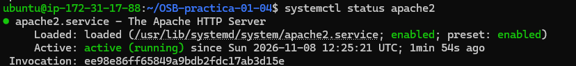
Esta evidencia muestra el estado del servicio Apache mediante `systemctl`. El estado `active (running)` confirma que el servidor web está funcionando correctamente.
### **Comprobación de instalación repetida**

Se ha vuelto a ejecutar el script de instalación para comprobar que detecta que Apache ya está instalado. El mensaje correspondiente confirma que no intenta realizar una instalación innecesaria.
## **6. Configuración del certificado autofirmado**
Para habilitar HTTPS se ha creado el archivo `scripts/.env`, que contiene los datos necesarios para generar el certificado.

Este archivo incluye información como el país, la localidad, la organización, el dominio, la IP elástica, los días de validez y las rutas de almacenamiento del certificado y de la clave privada.

A continuación, se ha ejecutado el script `setup_selfsigned_certificate.sh`:

`sudo ./scripts/setup_selfsigned_certificate.sh`

El script realiza las siguientes operaciones:

1. Comprueba que Apache está instalado.

2. Comprueba que existe el archivo `.env`.

3. Carga las variables de configuración.

4. Genera la clave privada y el certificado autofirmado mediante OpenSSL.

5. Añade el dominio y la IP elástica como nombres alternativos del certificado (SAN).

6. Protege la clave privada mediante permisos adecuados.

7. Copia y adapta los archivos de configuración de Apache.

8. Habilita los módulos SSL y Rewrite.

9. Activa el sitio HTTPS.

10. Comprueba la sintaxis de Apache y reinicia el servicio si la configuración es correcta.
### **Comprobación de los datos del certificado**
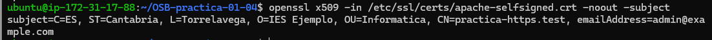
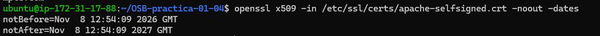
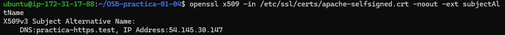
Se ha utilizado OpenSSL para consultar los datos del certificado generado:

`openssl x509 -in /etc/ssl/certs/apache-selfsigned.crt -noout -subject` `openssl x509 -in /etc/ssl/certs/apache-selfsigned.crt -noout -dates` `openssl x509 -in /etc/ssl/certs/apache-selfsigned.crt -noout -ext subjectAltName`

Con estas comprobaciones se verifica la información del titular, el periodo de validez y los nombres alternativos incluidos en el certificado.
## **7. Configuración del dominio**
Para poder acceder al servidor mediante el dominio `practica-https.test`, se ha añadido una entrada al archivo `hosts` del equipo desde el que se realizan las pruebas.

La entrada utilizada es:

`54.145.30.147 practica-https.test`

De esta forma, el dominio se resuelve hacia la dirección IP elástica de la instancia EC2.

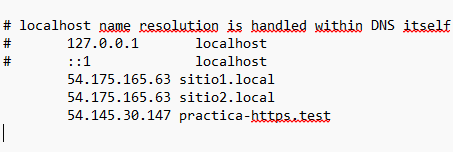

Esta captura muestra la entrada añadida al archivo `hosts`, asociando el dominio `practica-https.test` con la IP pública de la instancia.
## **8. Comprobaciones de funcionamiento**
Una vez configurado Apache y generado el certificado, se han realizado diferentes pruebas para comprobar el funcionamiento del servidor.
### **8.1. Comprobación de la redirección HTTP a HTTPS**
Se ha ejecutado el siguiente comando:

` curl -I  `[http://practica-https.test](http://practica-https.test)

El resultado esperado es un código de respuesta `301 Moved Permanently`, acompañado de una cabecera `Location` que indica la dirección HTTPS.

Esto confirma que las peticiones HTTP se redirigen automáticamente hacia conexiones seguras.

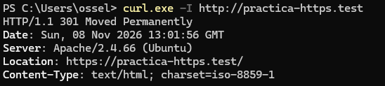

En esta captura se muestra el resultado de la petición HTTP. Se comprueba que el servidor devuelve una redirección permanente hacia HTTPS mediante el código 301.
### **8.2. Comprobación del acceso HTTPS**
Se ha realizado una petición HTTPS utilizando:

` curl -k -I  `[https://practica-https.test](https://practica-https.test)

Se utiliza la opción `-k` porque el certificado es autofirmado y no pertenece a una autoridad certificadora reconocida por defecto.

El resultado esperado es `200 OK`, lo que indica que el servidor ha respondido correctamente a la petición HTTPS.

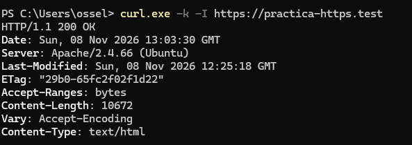

Esta evidencia muestra la respuesta del servidor al realizar una petición HTTPS. El código `200 OK` confirma que el contenido web se está sirviendo correctamente mediante una conexión cifrada.
### **8.3. Comprobación de la conexión TLS con OpenSSL**
Para comprobar la conexión segura se ha ejecutado:

`openssl s_client -connect practica-https.test:443 -servername practica-https.test < /dev/null`

El resultado muestra información sobre el certificado presentado por el servidor, el protocolo TLS negociado y el algoritmo de cifrado utilizado.

Durante la prueba se ha obtenido:

- Protocolo negociado: TLS 1.3.

- Clave pública: RSA de 2048 bits.

- Algoritmo de cifrado: TLS_AES_256_GCM_SHA384.

- Código de verificación: 18 (certificado autofirmado).

El código 18 es esperado, ya que el certificado ha sido generado localmente y no está firmado por una autoridad certificadora de confianza.

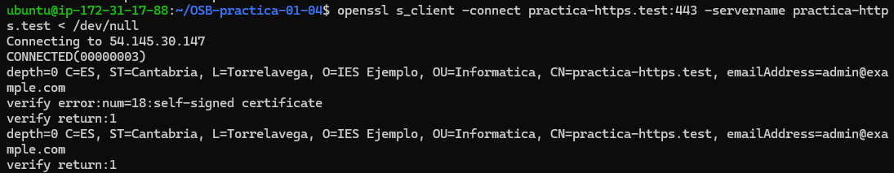
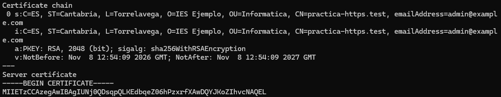
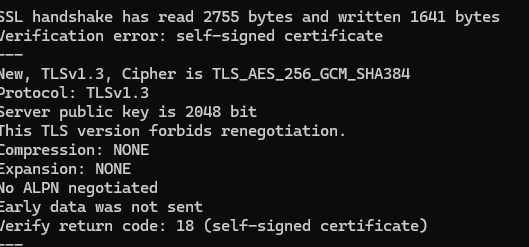

En esta captura se muestra la conexión establecida mediante OpenSSL. Se observa que la conexión se realiza correctamente y que se negocia TLS 1.3. También aparece el aviso de certificado autofirmado, que es normal en esta práctica.
### **8.4. Comprobación de los puertos y la configuración de Apache**
Se han utilizado los siguientes comandos:

`sudo apache2ctl configtest` `sudo ss -tlnp | grep apache2`

El primero permite comprobar que los archivos de configuración de Apache no contienen errores. El segundo permite comprobar que Apache está escuchando en los puertos correspondientes.

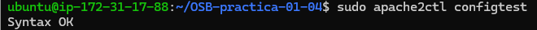
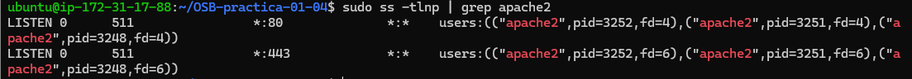

Esta captura muestra el resultado de la comprobación de sintaxis de Apache y los puertos en los que está escuchando el servidor. Se verifica que la configuración es correcta y que los puertos HTTP y HTTPS están disponibles.
## **9. Seguridad y archivos privados**
Para evitar publicar información sensible en el repositorio se ha configurado el archivo `.gitignore`.

Se excluyen los siguientes archivos:

`scripts/.env` `*.key` `*.crt`

El archivo `.env` contiene los datos utilizados durante la configuración y no debe publicarse en GitHub. Tampoco se deben subir las claves privadas ni los certificados generados.

En el repositorio únicamente se incluye `.env.example`, que sirve como plantilla para configurar el entorno.

## **10. Comprobación en navegador**
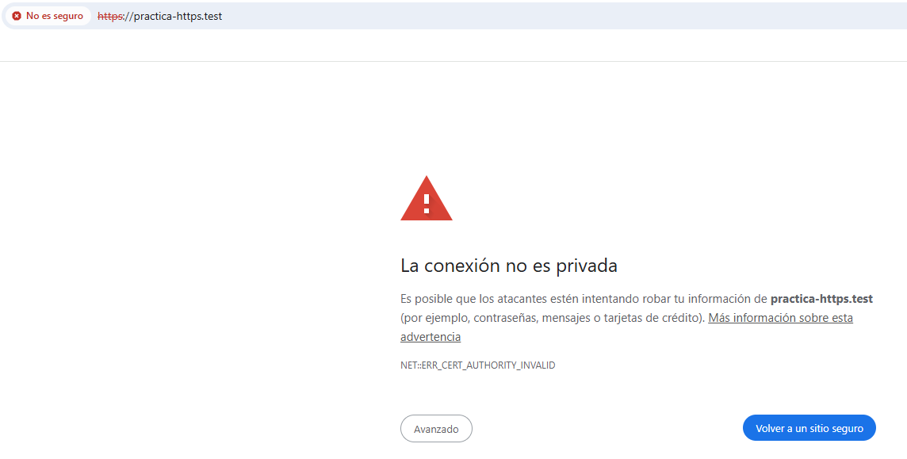
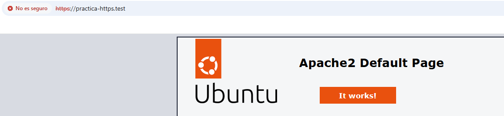

Aviso de CA no confiable; tras aceptarlo, se ve la web.

## **11. Conclusión**
Con esta práctica se ha conseguido instalar y configurar un servidor Apache en una instancia EC2 de AWS, habilitando el acceso mediante HTTPS utilizando un certificado autofirmado.

Se ha comprobado que Apache funciona correctamente, que las peticiones HTTP se redirigen hacia HTTPS y que el servidor establece conexiones cifradas mediante TLS 1.3.

También se ha verificado la información del certificado generado, incluyendo sus datos de identificación, su periodo de validez y los nombres alternativos correspondientes al dominio y a la dirección IP elástica.

Por último, se ha organizado el proyecto mediante scripts y archivos de configuración, facilitando su instalación y mantenimiento, y se han protegido los archivos que contienen información privada para evitar su publicación en GitHub.

La práctica ha permitido comprender el funcionamiento de HTTPS, la generación de certificados autofirmados y la configuración de un servidor web seguro en un entorno cloud.

